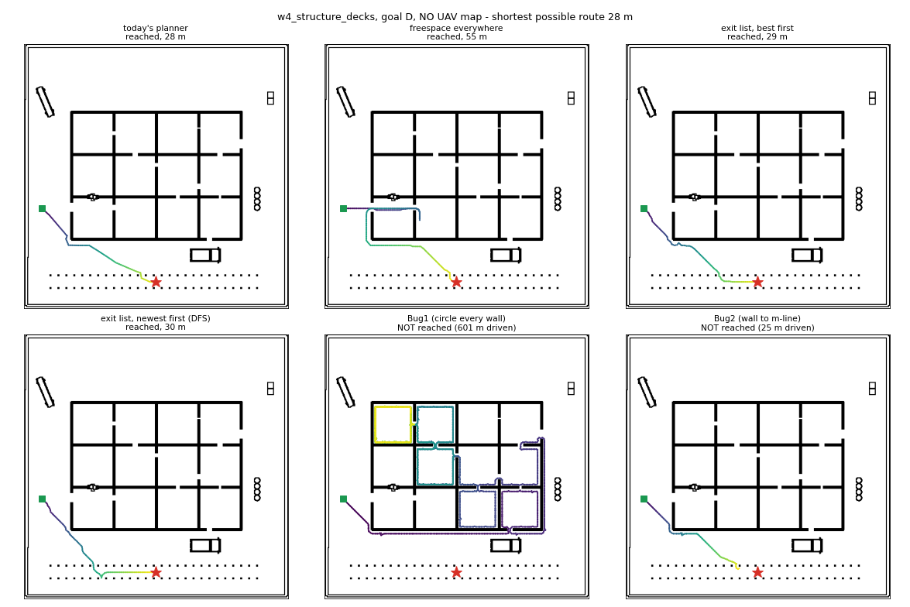
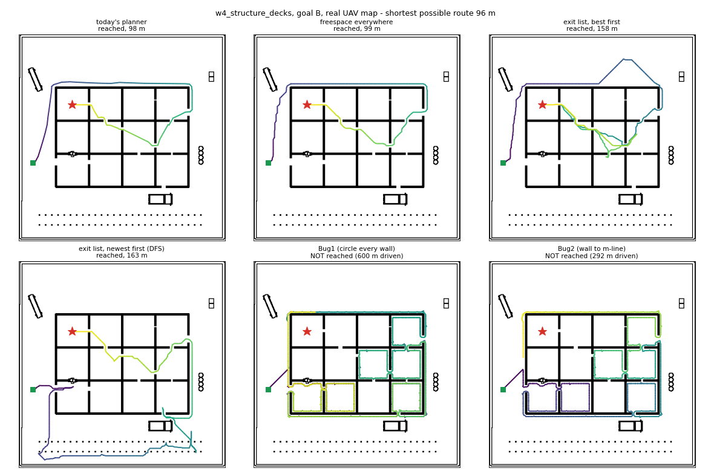

# Step 13 - Wall following and backtracking: testing the user's exploration idea (offline)

**Date:** 2026-10-29. **Status:** offline experiment done, nothing changed in the live stack. Verdict:
- With a UAV map, today's planner stays the best.
- Without a UAV map, "freespace everywhere" and a new **exit list (best first)** tie, and both beat today's planner.
- The literal wall-following ideas (Bug1, Bug2) and depth-first backtracking are much worse.
- A proposal (section 6) awaits approval.

**Reading order:**
1. the question
2. the ideas, explained
3. how they were tested
4. results
5. what it means
6. proposals

---

## 1. The question

In the live runs the UGV slides along a wall, reaches the next wall, turns back and tries somewhere else. That is a lot of
driving that achieves nothing (run 2 of step12: 443 m, 247 plans, 9 reversals of more than 90 deg).

The user asked whether a **systematic** search would do better when there is no UAV map:

> When the UGV hits a wall, it follows the wall. When it sees the same place again, it knows there is no way through there,
> so it goes back to an earlier point. When it finds a door, it goes through and repeats.

The user also proposed Gaussian smoothing of the map. That is **on hold** (user, 2026-10-29) and is not covered here.

## 2. The ideas, explained

The user's idea is two classic algorithms joined together.

### 2.1 Bug algorithms (Lumelsky & Stepanov, 1987): "follow the wall"

A robot that knows only where the goal is and can feel walls:

```
repeat:
    drive straight at the goal                       ("motion to goal")
    blocked by a wall at point H (the HIT point)?
        Bug1: follow the wall ALL the way round until back at H; remember the point L of the wall closest to the goal;
              go back to L (the shorter way) and drive at the goal again.
              If the goal direction is blocked right at L -> the goal cannot be reached.
        Bug2: follow the wall only until you are back on the straight line start->goal (the "m-line") at a point
              closer to the goal than H; leave the wall there.
```

- **Bug1** is the user's idea taken literally: "go round until I see the same place again".
  - It is *complete*: it always finds a way if there is one, and always notices when there is none.
  - The price is that every obstacle it meets is circled completely, so the path can be about 1.5 times the perimeter of
    every obstacle, plus the straight line.
- **Bug2** is usually much shorter, but it can loop around some shapes.

### 2.2 Trémaux / depth-first search: "go back to an earlier point"

The second half of the user's idea is maze solving:

- Go through the newest opening.
- When everything behind it is a dead end, return to the last place that still had an untried opening.

### 2.3 The lidar version: the exit list

The live UGV has a **360 deg lidar** that sees walls 6 m away, so it does not need to *touch* a wall to know it is there. From
a doorway it already sees most of a room's walls and openings. So instead of following walls:

```
every plan:
    if a route to the goal over OBSERVED ground exists -> drive it
    EXITS = groups of frontier cells (known, reachable floor next to unseen space), reachable from the robot
    score(exit) = known driving distance to it + straight-line distance from it to the goal
    keep the exit chosen last time while it is still there and not yet reached       (commitment: no flip-flopping)
    otherwise choose:  order="best": the lowest score                                  (best-first search)
                       order="dfs":  the most recently discovered exits first           (depth-first, = backtracking)
    no exits left -> the goal cannot be reached
```

A closed exit disappears from the list by itself once the lidar sees the wall behind it, so dead ends are remembered
without any extra bookkeeping. This is the "room-by-room, door-by-door" search the user described, done with the lidar instead
of the bumper.

## 3. How they were tested

### 3.1 Code (all offline, in `tests/nav/`, nothing in the live package)

| What | Where |
|---|---|
| Bug1 / Bug2 | [`BugPlanner`](../../../tests/nav/explore_wallfollow.py#L92) in `tests/nav/explore_wallfollow.py` |
| Exit list | [`ExitsPlanner`](../../../tests/nav/explore_wallfollow.py#L248), exits listed by [`exits()`](../../../tests/nav/explore_wallfollow.py#L265) |
| "Did not move" memory | [`_Bumper`](../../../tests/nav/explore_wallfollow.py#L57) |
| Unit tests (11) | `tests/nav/test_explore_wallfollow.py` |
| Experiment runner | `src/nav/scripts/eval_exploration.py`: new policies `bug1 bug2 exits_best exits_dfs`, `--maps none`, columns `shortest_m` / `ratio` |
| Path pictures | `src/nav/scripts/render_exploration_paths.py` -> `media/exploration/` |

How the pieces work:

- **The wall for Bug** is the edge of the cells where the robot's centre may stand: known obstacles grown by 0.35 m, with
  unseen cells counted as free.
  - The tracer is *Moore-neighbour contour tracing*. Starting from the blocked neighbour, it turns clockwise to the first free
    neighbour, which keeps the wall on the robot's left (test `test_trace_keeps_the_wall_on_the_left`).
  - If the robot loses the wall, for example because the map changed, it steps to the nearest edge cell and keeps its hit point.
- **The exit list** works like this:
  - It measures driving distance with Dijkstra over known free cells (`scipy.sparse.csgraph`).
  - It ignores frontier cells within 1.0 m of the robot. That ring is the lidar's blind ring, and choosing it made the robot
    stand still.
  - An exit may be a single cell wide. The 0.27 m inflation already guarantees the robot fits through.
- **The bump memory** (shared by all new strategies): if the robot did not move since the last plan, a virtual obstacle is
  put 0.3 m ahead of it.
  - The obstacle **expires after 15 plans**. A permanent one sealed W4's door B and gave a false "unreachable".
- **The comparison policies** are the same as in step12:
  - `adopted` = today's live configuration (A* + viewpoints + freespace under roofs);
  - `freespace1` = plan as if every unseen cell were free (D* Lite / Nav2 `allow_unknown`), everywhere.

### 3.2 Method

The offline simulator `tests/nav/explore_sim.py` (step09/12) works like this:

- Each step is: plan, drive 2 m, take a lidar scan (the live `floor_map_node` code), plan again.
- The robot drives at 0.5 m/s.
- A run is capped at 600 m.

The metric is **metres driven**. `shortest_m` is the shortest possible route on the true map, found with uniform-cost A*.
`ratio` = driven / shortest, where 1.0 is perfect. Three map set-ups:

| set-up | what the UGV starts with |
|---|---|
| **no UAV map** (`--maps none`) | nothing: every cell unseen; the case the user asked about |
| real UAV map + camera layer | W4's real live scan + the simulated UGV camera layer (the live configuration of step12) |
| real UAV map, no camera layer | W4's real scan with its false obstacles, camera layer off |

Goals:
- W4 structure decks, A-F. C is sealed: the right answer is "unreachable", found quickly.
- W5 door gauntlet, 1-3.
- W2 container yard, A, C and E. E is sealed.

### 3.3 Simulator limits (read before trusting small differences)

1. **Doors are about 0.4 m narrower than in Gazebo.**
   - The simulator's truth uses every LETHAL cell as a wall, and wall *edges* are LETHAL, so walls get thicker.
   - On W5 every door of 0.8 m and below is impassable in the simulator, so only W5 goals 1-3 are used.
2. **The simulated lidar is blocked by every LETHAL cell.** Low kerbs therefore hide what is behind them, which a real 2D
   lidar would see over.
3. **The camera layer is perfect.** Live, its false obstacles at door jambs are the main problem (step12 section 7). The
   simulator does **not** model them, nor Nav2's local planner, so it cannot show the live "dithering" at all.
4. **Bug2's failures are partly due to our implementation** (grid tracing, lost-wall handling). Bug2 is a weak baseline, not
   an exact replica of the paper.

### 3.4 A simulator bug found and fixed on the way

The W4 real map file contains the live run's own `ground_*` layers. The simulator kept them and added its simulated camera
cells *without* a `ground_confidence` layer. The 0.15 confidence gate (step12 7.3) then threw the simulated camera cells away,
so freespace no longer reached B.

The fix in `tests/nav/explore_sim.py`:
- the stored `ground_*` layers are dropped;
- the simulated camera writes `ground_confidence = seen`.

The baseline is restored (freespace B 97.6-98.7 m, as in step12). The *camera-layer* numbers in step12 were produced before
the gate existed and are not affected. Any offline camera-layer number produced between the gate's addition (2026-10-28) and
this fix would be.

## 4. Results

### 4.1 No UAV map (the user's case): 10 reachable goals

Metres driven to reach the goal. The shortest possible route is in brackets.

| goal (shortest) | today's planner | freespace everywhere | **exit list, best** | exit list, DFS | Bug1 | Bug2 |
|---|---|---|---|---|---|---|
| W4 A (63) | 96.7 | 89.0 | 90.3 | 92.0 | not reached (600) | 274.6 |
| W4 B (97) | 116.2 | 98.5 | 98.4 | 150.0 | not reached (600) | 322.3 |
| W4 D (28) | 27.8 | 54.9 | 28.5 | 29.6 | not reached (600) | false "unreachable" (25) |
| W4 E (62) | 123.8 | 86.5 | 96.1 | 126.4 | not reached (600) | 149.9 |
| W4 F (40) | 74.1 | 64.2 | 66.0 | 484.0 | not reached (600) | 99.5 |
| W5 1 (9) | 9.6 | 9.2 | 8.5 | 8.5 | 103.7 | 72.7 |
| W5 2 (17) | **gave up (12)** | 16.7 | 16.6 | 16.6 | gave up (102) | 82.0 |
| W5 3 (25) | **gave up (24)** | 25.0 | 24.4 | 24.4 | gave up (102) | gave up (116) |
| W2 A (33) | 36.7 | 33.2 | 33.8 | 83.6 | not reached (600) | not reached (600) |
| W2 C (47) | **stuck (46)** | 47.4 | 75.8 | 90.0 | not reached (240) | not reached (144) |
| **reached** | 7 / 10 | **10 / 10** | **10 / 10** | 10 / 10 | 1 / 10 | 6 / 10 |
| **metres, all 10 goals** | - | **524.6** | **538.4** | 1105.1 | - | - |
| metres, the 7 goals today's planner reaches | 484.9 | 435.5 | 421.6 | 974.1 | - | - |

Every Bug, freespace and exit-list number here was re-run on the final code (2026-10-29); the reruns were identical.

(The ten shortest routes add up to 421 m; a perfect explorer, which knows the map in advance, would drive exactly that.)

Sealed goals: how many metres before saying "unreachable". Less is better.

| goal | today's | freespace | exits best | exits DFS | Bug1 | Bug2 |
|---|---|---|---|---|---|---|
| W4 C | 467 | **116** | 369 | 395 | 600 (cap) | 600 (cap) |
| W2 E | 600 (cap) | **41** | 601 (cap) | 601 (cap) | 600 (cap) | 600 (cap) |

Pictures:
- `media/exploration/w4_noUAV_goalD.png` (below);
- `w4_noUAV_goalB.png`;
- `w2_noUAV_goalC.png`.



*W4 goal D: the goal is outside, south of the building. Freespace (top middle) drives into the building because the unseen
interior "might" be open, finds the wall and turns back: 55 m for a 28 m route. This is the user's "hits a wall and comes back"
pattern. The exit list (top right) does not enter, because the building's west side shows no opening towards the goal.
Bug1 (bottom middle) circles every room it meets and never gets to the goal.*

### 4.2 Real UAV map + camera layer (W4, live configuration)

| goal (shortest) | today's | freespace | exits best | exits DFS | Bug1 | Bug2 |
|---|---|---|---|---|---|---|
| A (63) | 90.4 | 90.6 | 91.0 | 105.8 | 355.8 | 222.3 |
| B (97) | 97.6 | 98.7 | 158.2 | 163.2 | not reached | false "unreachable" (292) |
| D (28) | 28.9 | 28.3 | 29.3 | 28.7 | 245.4 | false "unreachable" (25) |
| E (62) | 62.7 | 64.5 | 72.2 | 71.2 | not reached | 150.8 |
| F (40) | 61.7 | 66.1 | 65.7 | 298.0 | 406.2 | 98.4 |
| **total of A, B, D, E, F (shortest 290)** | **341.3** | 348.2 | 416.4 | 666.9 | - | - |
| sealed C: metres to give up | 115.8 | **113.3** | 348.0 | 387.7 | 600 | 292 |



With a UAV map, today's planner already drives within a few percent of the shortest route. The exit list commits to an exit
it chose with less information and loses 60 m on B. DFS drives round the whole site.

### 4.3 Real UAV map WITHOUT the camera layer (W4; the map has false obstacles)

| goal | today's | freespace | exits best | exits DFS | Bug1 | Bug2 |
|---|---|---|---|---|---|---|
| A | gave up (116) | gave up (121) | gave up (283) | gave up (231) | cap (600) | cap (600) |
| B | gave up (137) | gave up (141) | gave up (286) | gave up (237) | cap (600) | cap (600) |
| D | 28.1 | 28.7 | 30.1 | 28.9 | cap | cap |
| E | 62.7 | 72.2 | 72.8 | 72.3 | cap | cap |
| F | 68.1 | 70.1 | 70.0 | 216.5 | cap | cap |

No strategy reaches A or B: the false obstacles in the UAV map close the way in. Exploring harder only means driving further
before giving up. Here the fix is **perception** (a cleaner map), not the search strategy.

## 5. What it means

1. **The user's diagnosis is right: today's planner wastes driving when there is no UAV map.**
   - It reaches only 7 of 10 goals.
   - On W5 it gave up at doors it could pass, and on W2-C it got stuck next to the goal.
   - The reason: without a UAV map the "goal under a roof" rule never fires, so it falls back to the old viewpoint
     exploration, the strategy step12 replaced.
2. **The literal wall-following idea (Bug1) does not work here.** Circling every obstacle until you see the same place again
   is guaranteed to finish *in theory*, but in a building with many rooms and containers it spends the whole 600 m on the
   first few obstacles. Bug2 is shorter but loops and gives false "unreachable" answers.
3. **The idea behind it (systematic, door by door, remember dead ends) does work, done with the lidar:**
   - The exit list (best first) reached 10 of 10, within 3 % of freespace's total distance.
   - It fixes the "enter, find a wall, turn back" pattern (W4-D: 28.5 m vs 54.9 m).
   - On W2-C, though, it drove 28 m more than freespace (75.8 vs 47.4 m).
4. **Depth-first backtracking ("go back to the earlier point") is worse than best-first:** 1105 m vs 538 m.
   - Following the *newest* opening sends the robot away from the goal whenever a side door appears (W4-F: 484 m for a
     40 m route).
   - Backtracking itself is fine, because every strategy here backtracks automatically.
   - Choosing *which* opening to try by distance to the goal matters much more than choosing by "most recent".
5. **Giving up on sealed goals:** freespace is by far the fastest (41-116 m). The exit list keeps finding small openings
   (369 m on W4-C), which is its weak point.
6. **The live waste has a second cause the simulator cannot show:**
   - the camera's false obstacles at doors (step12 section 7);
   - re-plan churn (243 "plan blocked" re-plans in run 2).
   No search strategy fixes those. EX-05 (the flying-pixel filter) is still the next live step for the roofed-goal case.

## 6. Proposals (awaiting approval; nothing has been changed)

| # | proposal | evidence | effort |
|---|---|---|---|
| P1 | **When there is no UAV map, use freespace planning everywhere** (the same `nav/freespace.py` that `island_strategy:=freespace` already uses under roofs), instead of the viewpoint fallback | 10/10 vs 7/10; on the 7 goals both reach, 436 m vs 485 m; much the fastest to give up on sealed goals (41-116 m vs 467-600 m) | small: one switch in the planner node, then one live run without the UAV |
| P2 | Add the exit list's two good parts to freespace: **commitment** (keep a target while it is still open) and **"do not enter a building that shows no opening towards the goal"** | the exit list's W4-D (28.5 vs 54.9 m) | medium; offline first |
| P3 | Do NOT adopt Bug1/Bug2 or DFS ordering | section 4 | - |
| P4 | Keep EX-05 (flying-pixel filter) as the next live step for goals under roofs | section 4.3, step12 section 7 | as planned |

## 7. How to reproduce

```bash
source /opt/ros/humble/setup.bash && source install/local_setup.bash
cd src/nav/scripts
# no UAV map, W4 (about 15 min for all six strategies)
python3 eval_exploration.py --maps none --policies adopted freespace1 exits_best exits_dfs bug1 bug2
# W5 doors 1-3 and W2 (no UAV map)
python3 eval_exploration.py --world w5_door_gauntlet --maps none --goals 123 --policies adopted freespace1 exits_best
python3 eval_exploration.py --world w2_container_yard --maps none --goals ACE --policies adopted freespace1 exits_best
# real UAV map, with / without the camera layer
python3 eval_exploration.py --maps uavscan --policies adopted freespace1 exits_best exits_dfs bug1 bug2
python3 eval_exploration.py --maps uavscan --no-ground --policies adopted freespace1 exits_best exits_dfs bug1 bug2
# path pictures
python3 render_exploration_paths.py --world w4_structure_decks --map none --goal D \
    --policies adopted freespace1 exits_best exits_dfs bug1 bug2 --out ../../../media/exploration/w4_noUAV_goalD.png
```

Unit tests: `cd tests/nav && python3 -m pytest -q test_explore_wallfollow.py` (11 tests: the tracer keeps the wall on the
left, both Bugs get round a block, Bug1 circles it and Bug2 does not, a sealed box is reported, the exit list finds both doors
and picks the goal-side one, commitment, known-route shortcut, "no exits", DFS prefers the newest exit, bump memory expires).
